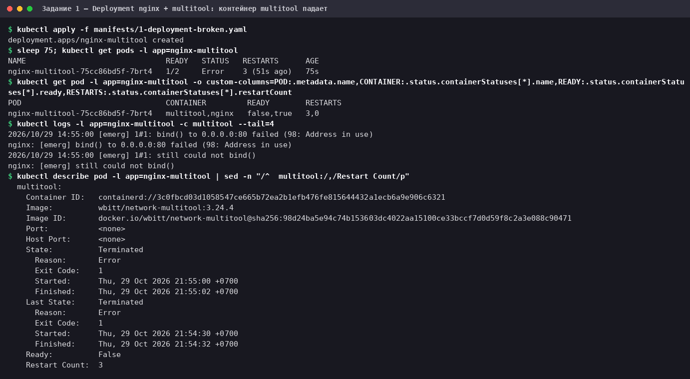
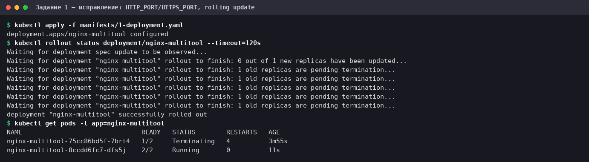
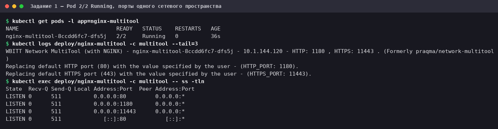
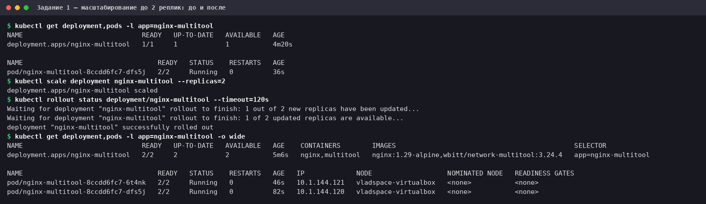
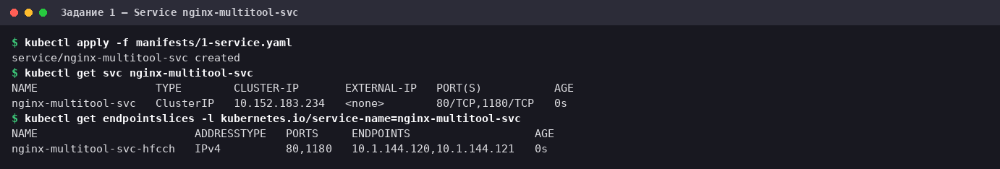
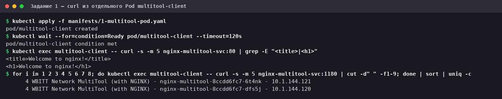
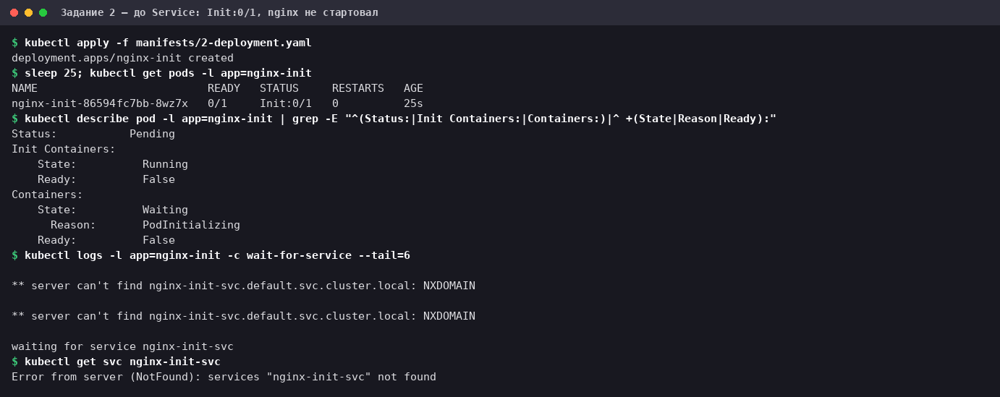
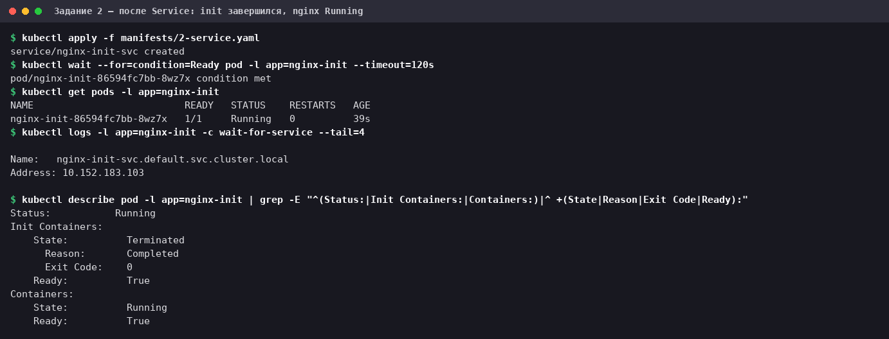
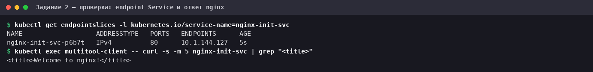

# Домашнее задание к занятию «Запуск приложений в K8S»

Стенд из предыдущих ДЗ: Oracle VirtualBox VM (Ubuntu 24.04.4 LTS), MicroK8s **v1.35.6** (один узел),
локальный `kubectl` **v1.37.1**. Всё выполнено в namespace `default`.

Манифесты лежат в каталоге [`manifests/`](manifests/):

| Файл | Объект |
|---|---|
| [`1-deployment-broken.yaml`](manifests/1-deployment-broken.yaml) | Deployment `nginx-multitool`, первая версия — с ошибкой (задание 1) |
| [`1-deployment.yaml`](manifests/1-deployment.yaml) | он же, исправленная версия |
| [`1-service.yaml`](manifests/1-service.yaml) | Service `nginx-multitool-svc` |
| [`1-multitool-pod.yaml`](manifests/1-multitool-pod.yaml) | Pod `multitool-client` — отдельный клиент для `curl` |
| [`2-deployment.yaml`](manifests/2-deployment.yaml) | Deployment `nginx-init` с init-контейнером busybox (задание 2) |
| [`2-service.yaml`](manifests/2-service.yaml) | Service `nginx-init-svc` |

Сырые логи команд — в [`logs/`](logs/), скриншоты — в [`img/`](img/).

## Задание 1. Deployment из двух контейнеров, масштабирование, Service

### 1.1. Первая версия и ошибка

[`manifests/1-deployment-broken.yaml`](manifests/1-deployment-broken.yaml) — Deployment с двумя контейнерами,
`nginx` и `multitool`, без дополнительных настроек:

```yaml
# Первая версия: оба контейнера слушают порт 80 в общем сетевом пространстве Pod'а —
# multitool не стартует (см. README, задание 1). Исправленная версия — 1-deployment.yaml.
apiVersion: apps/v1
kind: Deployment
metadata:
  name: nginx-multitool
  labels:
    app: nginx-multitool
spec:
  replicas: 1
  selector:
    matchLabels:
      app: nginx-multitool
  template:
    metadata:
      labels:
        app: nginx-multitool
    spec:
      containers:
        - name: nginx
          image: nginx:1.29-alpine
          ports:
            - containerPort: 80
        - name: multitool
          image: wbitt/network-multitool:3.24.4
```

```bash
kubectl apply -f manifests/1-deployment-broken.yaml
sleep 75; kubectl get pods -l app=nginx-multitool
kubectl get pod -l app=nginx-multitool -o custom-columns=POD:.metadata.name,CONTAINER:.status.containerStatuses[*].name,READY:.status.containerStatuses[*].ready,RESTARTS:.status.containerStatuses[*].restartCount
kubectl logs -l app=nginx-multitool -c multitool --tail=4
kubectl describe pod -l app=nginx-multitool | sed -n "/^  multitool:/,/Restart Count/p"
```



Pod в статусе `1/2 Error`: контейнер `nginx` работает (`READY=true`), а `multitool` завершается с кодом 1 и
перезапускается (3 рестарта за 75 секунд). В логе — причина:

```text
nginx: [emerg] bind() to 0.0.0.0:80 failed (98: Address in use)
```

**Почему так.** Все контейнеры Pod'а делят одно сетевое пространство, то есть один IP и один набор портов.
`nginx` уже занял порт 80. Образ `wbitt/network-multitool` — это набор сетевых утилит, и в нём тоже запускается
свой nginx, по умолчанию на портах 80 и 443. Двух слушателей на одном порту быть не может, поэтому второй
процесс падает с `Address in use`, и контейнер уходит в перезапуски (между попытками kubelet увеличивает
паузу, и статус сменяется с `Error` на `CrashLoopBackOff`).

### 1.2. Исправление

В описании образа ([Docker Hub](https://hub.docker.com/r/wbitt/network-multitool)) для этого случая есть
переменные окружения `HTTP_PORT` и `HTTPS_PORT`: они заменяют порты 80 и 443. Задаём multitool'у другие порты —
[`manifests/1-deployment.yaml`](manifests/1-deployment.yaml):

```yaml
# Исправленная версия: multitool слушает 1180/11443 вместо 80/443, которые занял nginx.
apiVersion: apps/v1
kind: Deployment
metadata:
  name: nginx-multitool
  labels:
    app: nginx-multitool
spec:
  replicas: 1
  selector:
    matchLabels:
      app: nginx-multitool
  template:
    metadata:
      labels:
        app: nginx-multitool
    spec:
      containers:
        - name: nginx
          image: nginx:1.29-alpine
          ports:
            - containerPort: 80
        - name: multitool
          image: wbitt/network-multitool:3.24.4
          env:
            - name: HTTP_PORT
              value: "1180"
            - name: HTTPS_PORT
              value: "11443"
          ports:
            - containerPort: 1180
```

Применяем поверх того же Deployment'а:

```bash
kubectl apply -f manifests/1-deployment.yaml
kubectl rollout status deployment/nginx-multitool --timeout=120s
kubectl get pods -l app=nginx-multitool
```



Kubernetes выполнил rolling update: создал новый Pod (`2/2 Running`), и только потом старый «сломанный» Pod
перешёл в `Terminating`. Состояние после того, как старый Pod исчез:

```bash
kubectl get pods -l app=nginx-multitool
kubectl logs deploy/nginx-multitool -c multitool --tail=3
kubectl exec deploy/nginx-multitool -c multitool -- ss -tln
```



В выводе `ss` видно, что в общем сетевом пространстве Pod'а теперь слушают три порта: `80` (nginx) и `1180`,
`11443` (multitool).

### 1.3. Масштабирование до 2 реплик

```bash
kubectl get deployment,pods -l app=nginx-multitool
kubectl scale deployment nginx-multitool --replicas=2
kubectl rollout status deployment/nginx-multitool --timeout=120s
kubectl get deployment,pods -l app=nginx-multitool -o wide
```



Было `1/1` и один Pod, стало `2/2` и два Pod'а с разными IP (`10.1.144.120`, `10.1.144.121`).

> В манифесте [`1-deployment.yaml`](manifests/1-deployment.yaml) оставлено `replicas: 1` — это состояние
> «до масштабирования». Масштабирование сделано командой, поэтому повторный `kubectl apply` этого файла вернул бы
> одну реплику. Чтобы закрепить две реплики декларативно, нужно поменять `replicas` в манифесте на `2`.

### 1.4. Service

[`manifests/1-service.yaml`](manifests/1-service.yaml) — ClusterIP, выбирает Pod'ы по метке `app: nginx-multitool`
и открывает оба приложения: nginx на `80` и multitool на `1180`:

```yaml
apiVersion: v1
kind: Service
metadata:
  name: nginx-multitool-svc
spec:
  type: ClusterIP
  selector:
    app: nginx-multitool
  ports:
    - name: nginx
      port: 80
      targetPort: 80
    - name: multitool
      port: 1180
      targetPort: 1180
```

```bash
kubectl apply -f manifests/1-service.yaml
kubectl get svc nginx-multitool-svc
kubectl get endpointslices -l kubernetes.io/service-name=nginx-multitool-svc
```



EndpointSlice содержит адреса **обеих** реплик (`10.1.144.120`, `10.1.144.121`) для портов `80` и `1180`.

### 1.5. Доступ из отдельного Pod'а

[`manifests/1-multitool-pod.yaml`](manifests/1-multitool-pod.yaml) — отдельный Pod с multitool. Он один в Pod'е,
поэтому порты по умолчанию ничему не мешают:

```yaml
# Отдельный Pod-клиент: с него проверяем доступ к репликам через Service.
# Он один в Pod'е, поэтому порты по умолчанию (80/443) ничему не мешают.
apiVersion: v1
kind: Pod
metadata:
  name: multitool-client
  labels:
    app: multitool-client
spec:
  containers:
    - name: multitool
      image: wbitt/network-multitool:3.24.4
```

С него обращаемся к Service по DNS-имени: к nginx — на порт 80, к multitool — на порт 1180. Для порта 1180
делаем 8 запросов и считаем, какой Pod ответил (multitool в ответе называет свой Pod):

```bash
kubectl apply -f manifests/1-multitool-pod.yaml
kubectl wait --for=condition=Ready pod/multitool-client --timeout=120s
kubectl exec multitool-client -- curl -s -m 5 nginx-multitool-svc:80 | grep -E "<title>|<h1>"
for i in 1 2 3 4 5 6 7 8; do kubectl exec multitool-client -- curl -s -m 5 nginx-multitool-svc:1180 | cut -d" " -f1-9; done | sort | uniq -c
```



- На порту `80` отвечает nginx (`Welcome to nginx!`).
- На порту `1180` отвечает multitool, причём **обе реплики**: по 4 ответа от `nginx-multitool-8ccdd6fc7-6t4nk`
  и `nginx-multitool-8ccdd6fc7-dfs5j`. Ровно пополам делить запросы Service не обязан — kube-proxy выбирает
  Pod случайно.

## Задание 2. Init-контейнер: nginx стартует только после появления Service

### 2.1. Манифесты

[`manifests/2-deployment.yaml`](manifests/2-deployment.yaml) — Deployment с nginx и init-контейнером `busybox`.
Init-контейнер в цикле проверяет через `nslookup`, есть ли в DNS кластера Service `nginx-init-svc`, и завершается,
только когда он появился. Пока init не завершился успешно, основной контейнер не запускается:

```yaml
# nginx стартует только после того, как в DNS кластера появится Service nginx-init-svc:
# пока init-контейнер не завершится успешно, основной контейнер не запускается.
apiVersion: apps/v1
kind: Deployment
metadata:
  name: nginx-init
  labels:
    app: nginx-init
spec:
  replicas: 1
  selector:
    matchLabels:
      app: nginx-init
  template:
    metadata:
      labels:
        app: nginx-init
    spec:
      initContainers:
        - name: wait-for-service
          # nslookup по полному имени: код 0, если Service есть в DNS, и 1, если нет (проверено на busybox 1.28 и 1.36)
          image: busybox:1.36
          command:
            - sh
            - -c
            - |
              NS=$(cat /var/run/secrets/kubernetes.io/serviceaccount/namespace)
              until nslookup nginx-init-svc.$NS.svc.cluster.local; do
                echo "waiting for service nginx-init-svc"
                sleep 2
              done
      containers:
        - name: nginx
          image: nginx:1.29-alpine
          ports:
            - containerPort: 80
```

[`manifests/2-service.yaml`](manifests/2-service.yaml):

```yaml
apiVersion: v1
kind: Service
metadata:
  name: nginx-init-svc
spec:
  type: ClusterIP
  selector:
    app: nginx-init
  ports:
    - port: 80
      targetPort: 80
```

### 2.2. Состояние до создания Service

Сначала применяем только Deployment:

```bash
kubectl apply -f manifests/2-deployment.yaml
sleep 25; kubectl get pods -l app=nginx-init
kubectl describe pod -l app=nginx-init | grep -E "^(Status:|Init Containers:|Containers:)|^ +(State|Reason|Ready):"
kubectl logs -l app=nginx-init -c wait-for-service --tail=6
kubectl get svc nginx-init-svc
```



- Pod в статусе `Init:0/1` и `READY 0/1`: init-контейнер `Running`, основной контейнер `nginx` — `Waiting`
  с причиной `PodInitializing`, то есть **nginx не стартует**.
- Лог init-контейнера: `server can't find nginx-init-svc.default.svc.cluster.local: NXDOMAIN` и
  `waiting for service nginx-init-svc` — он ждёт, пока имя Service не появится в DNS.
- Service действительно ещё нет: `Error from server (NotFound)` (последняя команда завершилась кодом 1 — так и
  должно быть).

### 2.3. Состояние после создания Service

```bash
kubectl apply -f manifests/2-service.yaml
kubectl wait --for=condition=Ready pod -l app=nginx-init --timeout=120s
kubectl get pods -l app=nginx-init
kubectl logs -l app=nginx-init -c wait-for-service --tail=4
kubectl describe pod -l app=nginx-init | grep -E "^(Status:|Init Containers:|Containers:)|^ +(State|Reason|Exit Code|Ready):"
```



Как только Service создан, `nslookup` в init-контейнере вернул адрес (`10.152.183.103` — ClusterIP Service),
init завершился (`Terminated`, `Reason: Completed`, `Exit Code: 0`), и запустился nginx: Pod `1/1 Running`.

Проверка, что Service теперь отдаёт nginx:

```bash
kubectl get endpointslices -l kubernetes.io/service-name=nginx-init-svc
kubectl exec multitool-client -- curl -s -m 5 nginx-init-svc | grep "<title>"
```



Обратите внимание на порядок событий: запись в DNS у Service появляется сразу при его создании, ещё до того, как у
него есть готовые endpoints. Поэтому init-контейнер завершился по факту существования Service, а endpoint
(`10.1.144.127`) появился чуть позже, когда стал готов сам Pod с nginx. Если бы init ждал готовых endpoints
Service'а, он ждал бы вечно: Pod, который должен их дать, не стартует, пока init не завершится.

## Как повторить и убрать стенд

```bash
kubectl apply -f manifests/1-deployment-broken.yaml    # увидеть ошибку
kubectl apply -f manifests/1-deployment.yaml           # исправление
kubectl scale deployment nginx-multitool --replicas=2
kubectl apply -f manifests/1-service.yaml -f manifests/1-multitool-pod.yaml
kubectl apply -f manifests/2-deployment.yaml           # Pod застрянет в Init:0/1
kubectl apply -f manifests/2-service.yaml              # ... и запустится

# удаление
kubectl delete -f manifests/1-multitool-pod.yaml -f manifests/1-service.yaml -f manifests/1-deployment.yaml
kubectl delete -f manifests/2-service.yaml -f manifests/2-deployment.yaml
```

Ссылка для сдачи: файл `README.md` этого репозитория.
